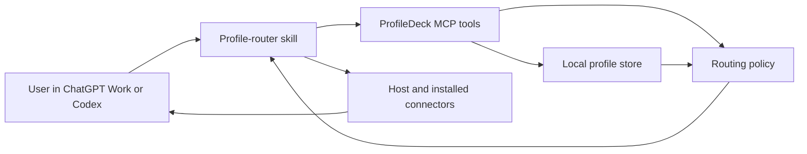

# Architecture

ProfileDeck combines reusable skills with an MCP server that stores profiles and
evaluates proposed routes. It intentionally does not execute third-party
connector actions.

## Components

The last step remains under host control. An `allow` result tells the
ProfileDeck workflow that the route fits the selected profile. It does not grant
connector access or suppress native confirmations.

## Plugin package

The installable package is `plugins/profiledeck`:

- `.codex-plugin/plugin.json` defines the plugin identity and metadata.
- `.mcp.json` starts the bundled Node.js server over stdio in Codex.
- `skills/profile-router` selects profiles and evaluates routes.
- `skills/personal-assistant` and `skills/work-assistant` provide profile-specific
  workflow guidance.
- `examples` contains complete example profile documents.
- `mcp/server.mjs` is generated by `pnpm build:plugin`.

The repository marketplace at `.agents/plugins/marketplace.json` exposes that
package for local testing.

The package does not currently contain `.app.json` or an `apps` manifest field.
ChatGPT Work can load the bundled skills and manually apply the canonical Personal or Work
policy in a conversation-scoped fallback. The fallback reference defines the connector and
approval rules, but it does not persist contexts or custom profiles. Persistent MCP contexts
require a deployed HTTPS endpoint and a
registered ChatGPT connection mapping.

## MCP tools

| Tool | Mutation | Purpose |
| --- | --- | --- |
| `list_profiles` | No | List available profiles without selecting one. |
| `get_profile` | No | Return a complete profile definition and revision. |
| `save_profile` | Destructive | Create a profile or revision-check an update that replaces the prior revision. |
| `delete_profile` | Destructive | Delete a profile and its associated contexts. |
| `open_profile` | Yes | Create an expiring context pinned to a profile snapshot. |
| `get_profile_context` | No | Inspect a current context and its pinned snapshot. |
| `close_profile_context` | Destructive | Irreversibly remove a pinned context snapshot without deleting its profile. |
| `evaluate_route` | No | Evaluate a skill or connector operation against a context. |

All tools have `openWorldHint: false` because the MCP server itself does not act
on an external system. `save_profile`, `delete_profile`, and `close_profile_context` are
marked destructive because their prior stored state is not
recoverable through the MCP API. Tool annotations are routing and review metadata, not authorization.

## Profile selection and contexts

The skill never infers Personal versus Work from message contents. The user
must explicitly select a profile.

`open_profile` accepts a profile ID and a time-to-live from 5 to 1,440 minutes;
the default is 480 minutes. The store copies the entire current profile into the
new context and records:

- An opaque UUID.
- Profile ID and revision.
- Full profile snapshot.
- Creation and expiration timestamps.

This snapshot is deliberate. If a profile is edited after a context opens, the
existing context continues to use the old snapshot. New contexts use the new
revision. Closing or expiration invalidates the context.

## Optimistic profile updates

New profiles may omit `revision`; the store creates them at revision `1`.

An update to an existing profile must include its current revision. The store
rejects a missing or stale revision, preventing a client from silently
overwriting a newer update. A successful update increments the revision.

This protects concurrent logical edits. An inter-process file lock also reloads the
latest state before each mutation, so local server processes sharing one data file do
not overwrite unrelated changes. The file store is still not a distributed database.

## Routing policy

`evaluate_route` requires a valid context plus at least one `skillId` or
`connectorId`. It evaluates:

1. Whether the skill is enabled in the profile.
2. Whether the connector appears in the profile.
3. Whether the operation is allowed for that connector.
4. Whether an explicit-only connector was explicitly requested.
5. Whether the profile's operation approval rule follows native behavior,
   always asks, or blocks.

The result is:

- `allow`: the proposed route fits ProfileDeck policy.
- `confirm`: ProfileDeck requires a visible user decision.
- `deny`: ProfileDeck must not use that capability within the routed workflow.

Every result includes a reminder that host authentication, workspace policy, and
confirmations still apply.

An unknown capability can either be denied or offered as a one-time confirmed
override, depending on `capabilities.unknownCapability`.

## Persistence

`FileProfileStore` keeps one validated state document containing:

- `schemaVersion: 1`
- Profiles
- Contexts

The default path is `~/.profiledeck/profiles.json`, overridable with
`PROFILEDECK_DATA_FILE`.

Mutations are serialized within one process and coordinated across processes with an
adjacent `proper-lockfile` lock. Every mutation reloads the latest state while holding
that lock. State is written to a temporary file and atomically renamed into place; a
backup-and-restore fallback avoids deleting the only valid copy on Windows. The file is
created with mode `0600` where the platform honors POSIX-style modes. Expired contexts
are treated as missing on reads and are removed from disk on the next mutation.

The current file store is appropriate for local use by processes that share one filesystem
path. A multi-host, multi-replica, or multi-tenant deployment needs a transactional
database, tenant keys, authenticated requests, and server-side authorization.

## Transports

### Stdio

`server/src/stdio.ts` connects one MCP server to the bundled stdio transport.
`pnpm build:plugin` bundles it to `plugins/profiledeck/mcp/server.mjs`.
Codex can use this bundled server directly. ChatGPT Work does not use the
bundled `.mcp.json` server as a registered connection.

### Streamable HTTP

`server/src/http.ts` exposes:

- `POST /mcp` for Streamable HTTP MCP requests.
- `GET /healthz` for a versioned health response.
- `GET /.well-known/openai-apps-challenge` when a verification token is
  configured.
- `GET /mcp` and `DELETE /mcp` as explicit `405 Method Not Allowed` responses.

The HTTP server binds to `127.0.0.1:3000` by default and refuses a non-loopback
bind unless the operator sets `PROFILEDECK_ALLOW_INSECURE_HTTP=1`. That override
does not add authentication or make the server production-ready.

For persistent contexts in ChatGPT Work, a maintainer must deploy this transport
at a public HTTPS URL, register it in ChatGPT developer mode, and add the real
connection mapping to the plugin. No such mapping is included in this
repository.

## Non-goals

ProfileDeck does not:

- Add profiles to regular Chat.
- Change ChatGPT memory, custom instructions, account identity, or workspace.
- Install, enable, disable, connect, disconnect, or revoke unrelated connectors.
- Verify that a descriptive connector label matches the authenticated account.
- Prevent other plugins or direct user actions from using installed tools.
- Provide hard Personal/Work data isolation.
Hard isolation requires a ProfileDeck-controlled adapter that authenticates the
user and enforces tenant, profile, resource, destination, and operation checks
server-side.
