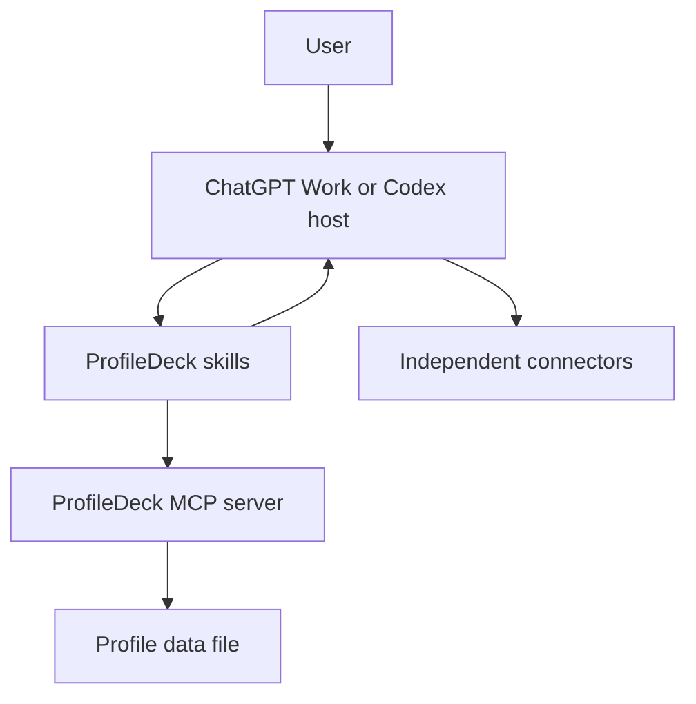

# Threat model

This threat model covers ProfileDeck `0.1.x` in local stdio and Streamable HTTP
configurations.

## Security objective

ProfileDeck should faithfully evaluate its own routing policy without exposing
stored profile data or allowing unauthorized profile mutation.

ProfileDeck is not intended to authorize third-party connector access. Native
host, workspace, and connector controls remain authoritative.

## Assets

- Profile definitions and revision history represented by the latest document.
- Behavioral and data-handling rules.
- Skill and connector identifiers and descriptive instance labels.
- Context IDs and pinned profile snapshots.
- Availability and integrity of the profile store.
- Deployment secrets and transport credentials supplied by an operator.

Credentials, raw chats, and connector payloads are prohibited profile content
and should not become ProfileDeck assets.

## Trust boundaries

Important boundaries:

- User input and model-generated tool arguments are untrusted.
- Context IDs are opaque selectors, not authentication credentials.
- The host-to-MCP transport needs deployment-appropriate authentication.
- Connector authentication and actions occur outside the ProfileDeck MCP server.
- The local filesystem and deployment operator are trusted in the default model.

## Threats and controls

### Profile confusion

**Threat:** Sensitive text causes the system to infer Work or Personal without
the user choosing it.

**Controls:** The skill requires explicit selection. Missing or expired contexts
produce `PROFILE_REQUIRED`, and switching applies only to future work.

### Stale update overwrite

**Threat:** Two clients edit a profile and the older client overwrites the newer
state.

**Controls:** Updates require the exact current revision and increment it after a
successful save. Missing or stale revisions are rejected.

**Residual risk:** Cross-process locking and reload-before-mutation protect processes on one
host that share the same local data file. Network filesystems, multi-replica deployments,
and storage that does not preserve the expected lock, timestamp, and atomic-rename semantics
remain unsupported.

### Context policy drift

**Threat:** A profile edit silently changes policy in an already-running
conversation.

**Controls:** Each context stores the complete selected profile snapshot and
revision. Later edits affect new contexts only.

**Residual risk:** Existing contexts intentionally retain older policy until
closed or expired. Users should reopen a context when they need new policy
immediately.

### Cross-profile data mixing

**Threat:** Personal and Work information is mixed in one conversation or sent
to the wrong connector instance.

**Controls:** The skill states the selected profile, recommends a new chat when
switching could mix context, supports explicit-only connectors, and asks for a
destination.

**Residual risk:** ProfileDeck cannot erase conversation history, verify the
authenticated external account, or block unrelated connectors.

### Prompt injection and route bypass

**Threat:** Untrusted content instructs the model to skip `evaluate_route`,
invent a context, or treat `allow` as authorization.

**Controls:** Skill and server instructions require a real context and a route
check. Tool schemas validate inputs. Results always include the native-policy
reminder.

**Residual risk:** Skills guide model behavior; they are not a hard enforcement
layer over independently installed tools. High-assurance deployments require a
ProfileDeck-controlled connector adapter with server-side authorization.

### Profile import or stored-data injection

**Threat:** A crafted profile includes executable content, excessive data, or
secrets.

**Controls:** Zod schemas restrict structure, enums, collection sizes, and string
lengths. Profiles are data and are never executed by the MCP server.

**Residual risk:** Behavioral instructions can still contain adversarial text.
Users must review profile changes, and deployments should add content and size
controls before accepting untrusted imports.

### Local file disclosure or corruption

**Threat:** Another local user reads or changes the JSON store, or a write leaves
partial state.

**Controls:** Restrictive file mode where supported, strict schema validation,
cross-process file locking, reload-before-mutation, temporary-file writes, atomic rename,
and a backup-and-restore fallback for Windows rename failures.

**Residual risk:** Filesystem permissions vary by operating system. A user or
administrator with access to the account can read or alter the file. There is no
encryption at rest in the application.

### HTTP exposure

**Threat:** An unauthenticated remote caller reads or changes profiles.

**Controls:** Loopback binding by default and an explicit refusal to bind
remotely without `PROFILEDECK_ALLOW_INSECURE_HTTP=1`.

**Residual risk:** The override adds no authentication. The current server is not
safe for direct internet exposure or multi-user use.

### Host-header and DNS-rebinding attacks

**Threat:** A malicious origin reaches a loopback MCP server through an
unexpected host.

**Controls:** The MCP SDK Express helper applies host validation, and deployments
can set `PROFILEDECK_ALLOWED_HOSTS`.

**Residual risk:** Operators can weaken the allowlist or proxy configuration.
Browser-origin protections and authentication still need deployment review.

### Sensitive logs and errors

**Threat:** Tokens, profiles, or tool inputs appear in logs.

**Controls:** Tool errors return concise messages, and the application does not
intentionally log request bodies or profile documents.

**Residual risk:** The HTTP layer logs caught error objects, while reverse
proxies and platforms may log request metadata or bodies. Operators must redact
and restrict logs.

### Supply-chain compromise

**Threat:** A dependency, workflow, or release bundle is modified.

**Controls:** Exact lockfile, CI checks, dependency updates, CodeQL, generated
artifact validation, release checksums, and private vulnerability reporting.

**Residual risk:** Dependency review and release provenance require continuing
maintainer attention.

## Out of scope

The following documented limitations are not vulnerabilities by themselves:

- A user directly invoking an unrelated connector outside ProfileDeck.
- An installed connector remaining connected after profile switching.
- ChatGPT memory or earlier conversation text remaining available.
- A descriptive instance label not matching the authenticated account.
- A native host policy requiring more confirmation than ProfileDeck.
- Regular Chat not supporting this plugin.
Report behavior that contradicts the documented policy or crosses a boundary
ProfileDeck claims to enforce through [SECURITY.md](../SECURITY.md).
